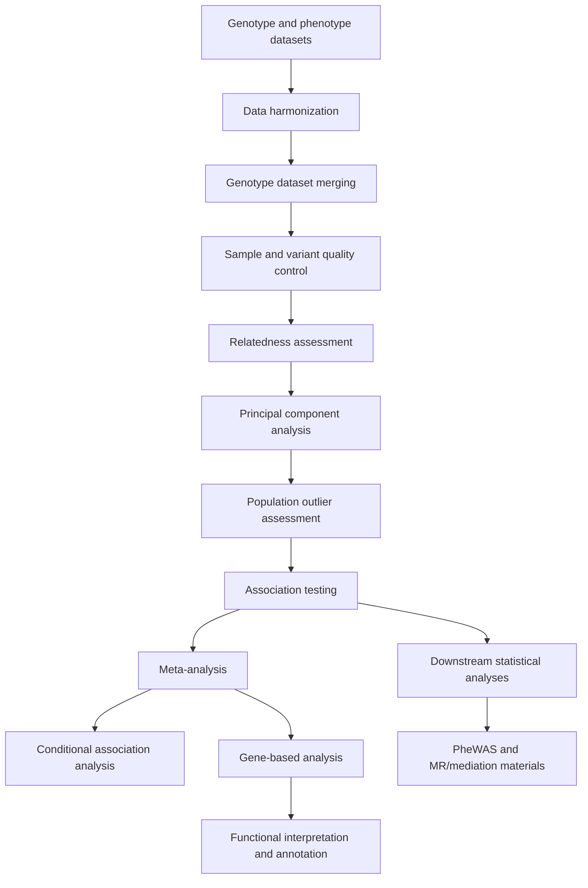

# CCE_ACTREC_GBC_GWAS

[](https://github.com/CCE-Consortium/CCE_ACTREC_GBC_GWAS)
[](https://github.com/CCE-Consortium/CCE_ACTREC_GBC_GWAS)
[](https://github.com/CCE-Consortium/CCE_ACTREC_GBC_GWAS)

A research repository containing computational workflows, scripts, configuration files, and analysis documentation for the **Gallbladder Cancer (GBC) Genome-Wide Association Study (GWAS)** conducted under the CCE–ACTREC research collaboration.

---

## Table of Contents

- [Overview](#overview)
- [Objectives](#objectives)
- [Analysis Workflow](#analysis-workflow)
- [Repository Structure](#repository-structure)
- [Methods and Analysis Components](#methods-and-analysis-components)
- [PheWAS and Mendelian Randomization (MR) Analysis](#7-phewas-and-mendelian-randomization-mr-analysis)
- [Software and Tools](#software-and-tools)
- [Reproducibility and Usage](#reproducibility-and-usage)
- [Data Availability and Privacy](#data-availability-and-privacy)
- [Citation](#citation)
- [Acknowledgements](#acknowledgements)
- [Contact](#contact)

## Overview

Genome-wide association studies investigate statistical associations between genetic variants and a phenotype of interest. This repository organizes the scripts and supporting materials used in the GBC GWAS analysis, including genotype quality control, population-structure assessment, data harmonization, association testing, conditional analysis, gene-based analysis, and downstream statistical analyses.

The repository is intended to support transparent documentation, organization, and reproducibility of the computational analyses. Individual scripts and configuration files should be consulted for the exact parameters, input requirements, and outputs used in each analysis.

## Objectives

The analytical work represented in this repository includes:

- Preparing and harmonizing genotype datasets from different sources or projects.
- Performing variant-level and sample-level quality control.
- Assessing cryptic relatedness and population structure.
- Conducting principal component analysis (PCA) and identifying population outliers.
- Performing genome-wide association testing using logistic-regression and meta-analysis workflows.
- Investigating independent signals through conditional association analysis.
- Conducting gene-based association analysis using MAGMA-related workflows.
- Organizing downstream statistical, gender-stratified, interaction, PheWAS, and Mendelian randomization/mediation analysis materials where available.

## Analysis Workflow

The major analysis components can be viewed as the following workflow. The exact order and dependencies should be confirmed against the relevant analysis scripts and project records.



## Repository Structure

The repository is organized into the following main directories:

| Directory | Description |
|---|---|
| `Quality control and Population stratification/` | PLINK quality-control logs and scripts, sample/variant filtering, cryptic-relatedness assessment, PCA, outlier removal, and imputation-related resources. |
| `Data Harmonization/` | Resources and scripts for genome-coordinate liftover, harmonization, and pre-QC merging of datasets. |
| `Association Analysis/` | Association-analysis resources, logistic-regression/meta-analysis workflows, and related R scripts. |
| `Association And Statistical Analyses/` | Stata do-files for data coding, descriptive summaries, SNP association models, gender-stratified analyses, and interaction analyses. |
| `Conditional Association Analysis/` | Python implementation of iterative stepwise conditional association analysis using GCTA-COJO. |
| `Gene-Based Association Analysis/` | MAGMA gene-based analysis and R code for gene-based Manhattan plot generation. |
| `FUMA_Configuration/` | FUMA and Gene2Function parameter configuration files for functional annotation workflows. |
| `PheWas and Mendelian Randomization Mediation Analysis/` | Directory reserved for PheWAS and Mendelian randomization/mediation analysis materials; consult the folder contents for currently available files. |

### Selected scripts and resources

- **Quality control:** `1_QC-Till-PCA.txt`, `2_QC-Only-For-PCA.txt`, and `3_PostPCA-OutlierRemoval.txt` document PLINK-based QC and PCA-related steps.
- **Sample checks:** `Samples_Issues_Gender_CrypticRelatedness.py` contains Python utilities for sample, gender, and cryptic-relatedness checks.
- **PCA visualization:** `PC1vsPC2_Expanded Cohort.R` supports visualization of principal components.
- **Dataset merging:** `MergingCommonSNPs_In_DifferentProjects-v2.py` supports identification and merging of common SNPs across projects.
- **Liftover:** `Lift_Karade_SingleThreaded.py` and the related liftover resources support genome-coordinate conversion.
- **Association analysis:** `STD_Meta_SNP-GENE-Cytobands_withSNP.R` supports downstream annotation/visualization of meta-analysis results.
- **Conditional analysis:** `IterativeStepwiseConditionalAnalysis_v3.0_SingleThreaded.py` implements iterative conditional analysis with GCTA-COJO input preparation.
- **Gene-based analysis:** `GBC_MAGMA_GBC_MAGMA Plot_Meta_Initial Cohort_Expanded Cohort.R` generates a MAGMA gene-based Manhattan plot.
- **Functional annotation:** `FUMA_Configuration/` contains parameter files for FUMA and Gene2Function workflows.

For the latest file list and exact file locations, see the [repository directory](https://github.com/CCE-Consortium/CCE_ACTREC_GBC_GWAS).

## Methods and Analysis Components

### 1. Data harmonization

The data-harmonization resources include genome-coordinate liftover and pre-QC merging utilities. Coordinate conversion is important when datasets use different genome assemblies. Confirm the source and target assembly, reference files, and successful conversion rate before combining datasets.

### 2. Genotype quality control and population stratification

The QC resources document PLINK-based sample- and variant-level filtering. The available logs include steps involving genotype missingness, minor allele frequency, Hardy–Weinberg equilibrium, duplicate-variant checks, and sample missingness. PCA-related scripts and logs support population-structure assessment and outlier review.

**Important:** QC thresholds should be interpreted in the context of the analysis, cohort composition, ancestry, and study protocol. Do not assume that a threshold in one log applies to every dataset or analysis branch.

### 3. Association analysis and meta-analysis

The association-analysis resources include logistic-regression and meta-analysis workflows. The repository also contains Stata scripts for descriptive summaries, coding/cleaning, SNP models, gender-stratified analyses, and interaction analyses.

Refer to the corresponding script and log for the covariates, model specification, sample definition, variant filters, and meta-analysis settings used in a particular analysis.

### 4. Conditional association analysis

The Python script `IterativeStepwiseConditionalAnalysis_v3.0_SingleThreaded.py` is designed for iterative conditional analysis using GCTA-COJO. Its documented functionality includes input-format detection, conversion of logistic-regression or meta-analysis summary statistics to COJO format, iterative signal selection, and convergence visualization.

Use the script documentation and GCTA-COJO requirements to prepare compatible summary statistics and reference inputs.

### 5. Gene-based association analysis

The gene-based analysis directory contains an R script for processing MAGMA gene-level results and generating a Manhattan plot. The script expects gene-level fields such as chromosome, start, stop, gene symbol, and p-value. Check the script for its specific significance threshold and plotting settings.

### 6. Functional annotation and downstream analyses

FUMA configuration files are provided for functional annotation and Gene2Function workflows. The repository also has a directory for PheWAS and Mendelian randomization/mediation analysis materials. Confirm which result files and scripts are currently available before interpreting or reproducing these downstream analyses.

### 7. PheWAS and Mendelian Randomization (MR) Analysis

PheWAS and Mendelian Randomization (MR) are complementary downstream approaches that can help investigate the broader phenotypic associations of genetic variants and explore potential causal relationships between exposures and outcomes.

For researchers who would like to refer to the code and workflow for **PheWAS and MR analyses**, the following repository is provided as an additional resource:

- **PheWAS and MR analysis code:** [MRCIEU/gbc-mr](https://github.com/MRCIEU/gbc-mr)

Please refer to the linked repository for the relevant code, implementation details, and instructions for these analyses. This resource is provided as a reference for researchers interested in conducting or adapting PheWAS and MR analyses; it is separate from the main GWAS workflow documented in this repository.

## Software and Tools

The repository contains materials associated with the following tools and programming languages. The exact version used may vary by analysis and should be recorded from the original execution environment.

| Tool / Language | Role in the repository |
|---|---|
| [PLINK](https://www.cog-genomics.org/plink/) | Genotype quality control and genetic association workflows |
| [Python](https://www.python.org/) | Data processing, sample checks, dataset utilities, and conditional-analysis workflow |
| [R](https://www.r-project.org/) | Statistical analysis, data processing, and visualization |
| [Stata](https://www.stata.com/) | Data cleaning, descriptive statistics, regression, stratified and interaction analyses |
| [GCTA-COJO](https://yanglab.westlake.edu.cn/software/gcta/) | Conditional and joint analysis of GWAS summary statistics |
| [MAGMA](https://ctg.cncr.nl/software/magma) | Gene-based association analysis |
| [FUMA](https://fuma.ctglab.nl/) | Functional mapping and annotation of GWAS results |
| [UCSC liftOver](https://genome.ucsc.edu/cgi-bin/hgLiftOver) | Conversion of genomic coordinates between reference assemblies |

## Reproducibility and Usage

This repository is primarily a collection of analysis scripts, logs, and configuration files. It is not necessarily a self-contained, one-command pipeline. Reproducing an analysis may require approved genotype/phenotype datasets, reference panels, genome reference files, external software, and project-specific input/output paths.

Suggested procedure:

1. **Review the analysis folder.** Start with the relevant directory and read its scripts, logs, and accompanying notes.
2. **Identify required inputs.** Confirm input file formats, sample identifiers, genome assembly, reference files, and phenotype/covariate definitions.
3. **Check software requirements.** Install the required tools and use compatible versions. Record versions in the analysis record.
4. **Review paths and parameters.** Update machine-specific input/output paths only after confirming the intended files and settings.
5. **Run a small validation first.** Test the workflow on a permitted subset or validation dataset before running the full analysis.
6. **Record outputs and provenance.** Save logs, command lines, software versions, parameter choices, and input dataset identifiers in accordance with project policy.

### Clone the repository

```bash
git clone https://github.com/CCE-Consortium/CCE_ACTREC_GBC_GWAS.git
cd CCE_ACTREC_GBC_GWAS
```

### Navigate to an analysis directory

For example:

```bash
cd "Quality control and Population stratification"
```

The commands above only download the repository and navigate its folders. They do not execute the complete analysis. Follow the relevant script instructions and project-approved workflow for execution.

## Data Availability and Privacy

This repository may contain code, configuration files, logs, and supporting research materials. The presence of a script does not imply that the underlying participant-level genotype, phenotype, or other sensitive data are publicly available.

- Do not commit identifiable, participant-level, or otherwise restricted data.
- Do not upload credentials, access tokens, private keys, or restricted reference data.
- Share or use study data only in accordance with institutional approvals, consent conditions, data-use agreements, and applicable policies.
- Before making the repository public or adding files, review them for personal information, protected health information, sample identifiers, and sensitive file paths.
- Treat logs and configuration files as potentially sensitive because they may contain internal paths or sample-level details.

## Citation

If you use methods, scripts, or results from this repository, cite the relevant study or manuscript when available and acknowledge the CCE–ACTREC research collaboration in accordance with the project team's guidance.

A formal citation, DOI, and publication details should be added here once approved by the project investigators. Do not cite this repository as a substitute for the primary scientific publication.

## Acknowledgements

We acknowledge the investigators, researchers, clinicians, data-management teams, and technical contributors involved in the CCE–ACTREC GBC GWAS research collaboration.

Please follow the project team's instructions for the exact institutional names, author list, funding statements, and acknowledgements in publications or external presentations.

## Contact

For questions about the scientific methods, data access, or reuse of this repository, please contact the corresponding project investigators or the CCE–ACTREC research team through the official institutional channels.

---

**Repository:** [CCE-Consortium/CCE_ACTREC_GBC_GWAS](https://github.com/CCE-Consortium/CCE_ACTREC_GBC_GWAS)

**Disclaimer:** This README provides a high-level guide to the repository. The analysis scripts, configuration files, logs, approved study protocol, and project documentation remain the authoritative sources for exact analytical decisions and reproducibility.
